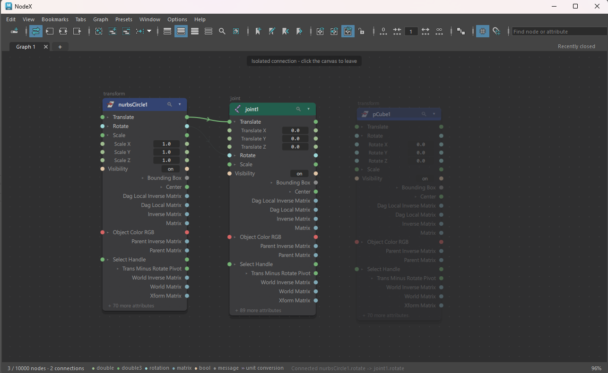

# NodeX

A refreshed node editor for Autodesk Maya. The graph is a Qt Quick (QML) board hosted in a
Maya panel, driven by a Python bridge that reads and writes the live scene through OpenMaya 2.

The chrome stays Maya's own; the refresh lives in the node plates, and colour keeps the meaning
Maya already gives it. Colours are derived from your Maya colour preferences (`userRGBColors2.mel`),
not hand-picked.



## Features

- Pannable, zoomable board with level-of-detail rendering for large graphs
- Display modes matching Maya's Node Editor (simple, connected, full, custom) plus node filter and find
- Drag-to-connect wiring, link-drag search, bulk connect by name, reroute, swap, transfer
- Inbetween nodes and unit-conversion nodes handled as part of the wire
- Value fields with drag-slide, multi-field sweep and typed entry (one undo step)
- Copy / paste / duplicate of node fragments, plus JSON presets
- Graph tabs, node positions and frames saved inside the scene (network node `nodexBoard`)
- Auto layout: layered rearrange, align, grid, straighten

Keys: see [HOTKEYS.md](HOTKEYS.md), or Help > Keys inside the editor.

## Requirements

- Windows, Maya 2025 or newer (PySide6), tested on Maya 2026.
- Maya 2022–2024: use NodeX 1.0.0. Installing 2.0.0 removes NodeX from those versions on the same machine.
  The two releases share one install, so only one can be installed per user: running the 1.0.0
  installer afterwards replaces 2.0.0 for every Maya version.

## Install

1. Build the archive (or take a release): `python build.py` produces `dist/NodeX-<version>.zip`.
2. Unpack it anywhere, keeping `install.py` next to the `NodeX` folder.
3. Drag `install.py` into a Maya viewport.

This installs a per-user Maya module, a shelf button and a **Windows > NodeX Node Editor** menu
item. Your own `userSetup.py` is not touched. Details: [installer/README.txt](installer/README.txt).

Installed a newer Maya later? Drag `install.py` into it once: the module is only enabled for the
Maya versions it was installed from.

Run from Python without installing:

```python
import nodex
nodex.show()
```

(with the repository root on `sys.path`).

## Development

```
nodex/        the package: model, ops, bridge, panel, QML board (nodex/qml)
installer/    drag-and-drop installer and userSetup
tools/        build_palette.py (colours from Maya prefs), build_shaders.py (QML shaders to .qsb
              with Maya's qsb), extract_icons.py (Maya icon dump)
tests/        unittest suites and QML probes
build.py      packs dist/NodeX-<version>.zip
```

Tests run headless under `mayapy`:

```
tests\run.bat
```

Set `MAYAPY` to point at another Maya version (default: Maya 2026 in `Program Files`).

## License

[MIT](LICENSE)
